# Laboratorio #7


## Sistemas de Gestión de Base de Datos (DBMS)Archivo

En la laboratorio #7 se comparte un un documento pdf en el que se estarán realizando dos ejercicios relacionados a creaciones de bases de datos, tablas y manipulación de datos .

# Ejercicio 1

### Parte 1: Creación de la base de datos y las tablas

#### Se crea la base de datos en este caso `inventariotienda`

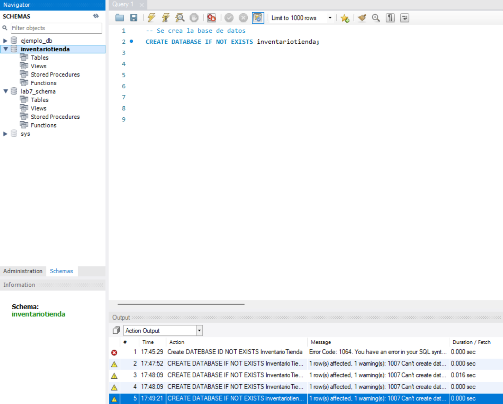

#### Se crea la tabla en este caso `Productos`

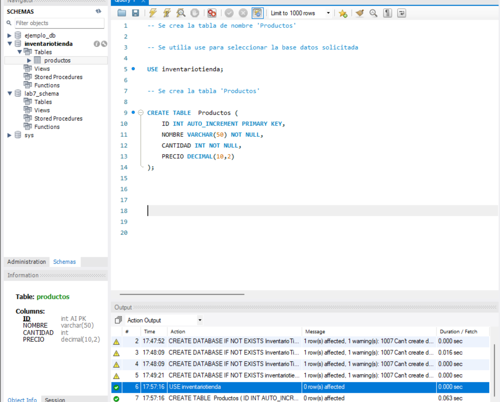

#### Parte 2: Inserción de datos
#### Se incertan los tres productos

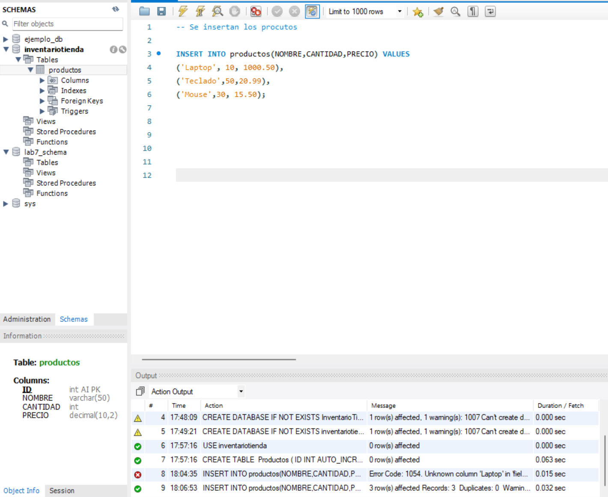

#### Parte 3: Consultas SQL

#### Se seleccionan todos los productos
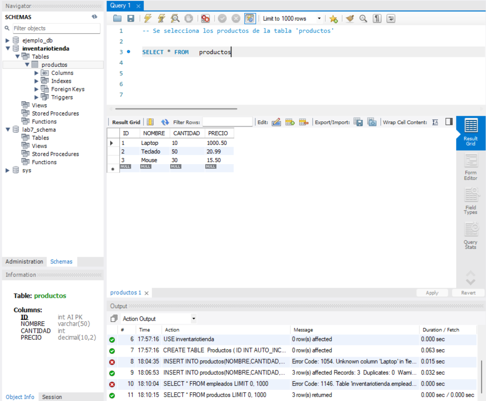

#### Se actualiza el valor de la cantidad de Mouse a '25'

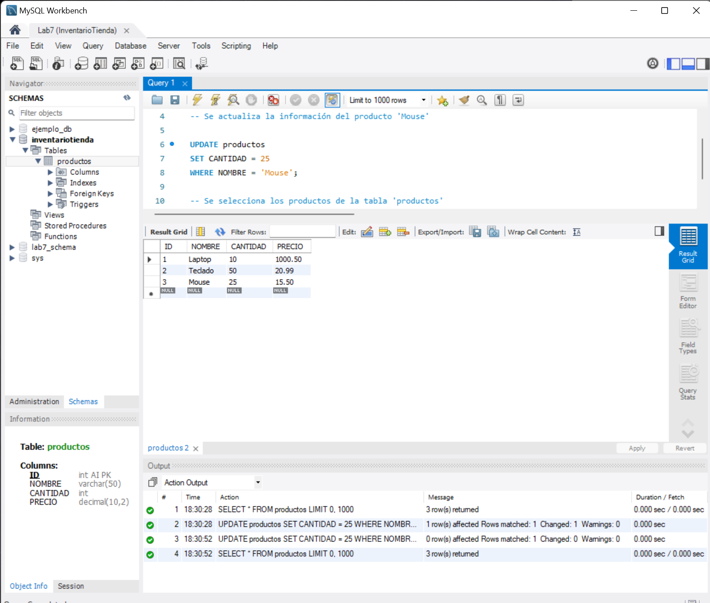

#### Se elimina el producto 'Teclado'
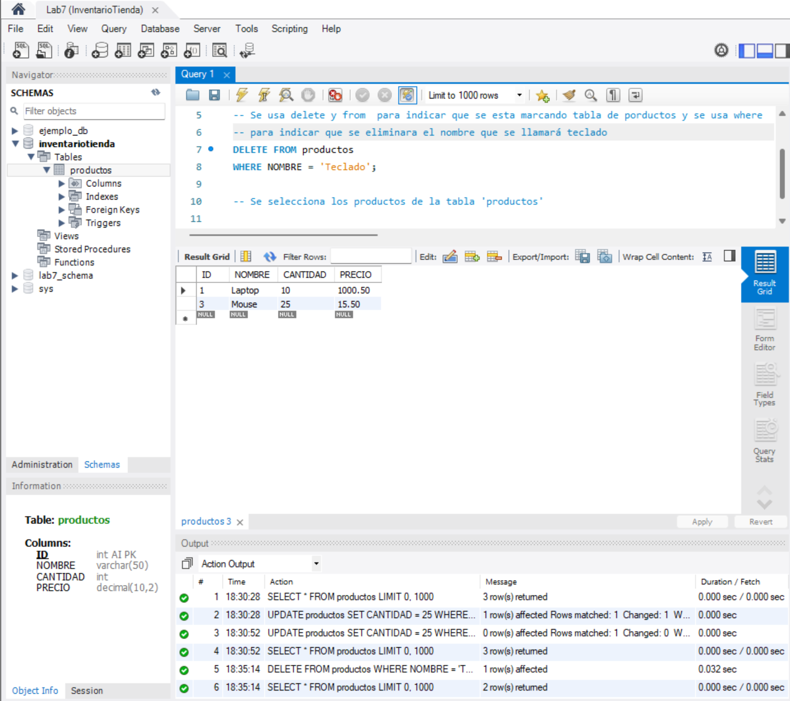

#### Se muestra solamente el precio de 'Laptop'

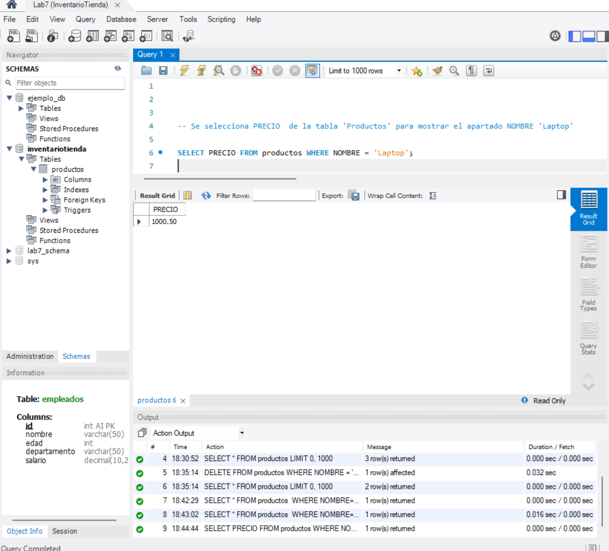

#### Parte 4: Discusión

#### - ¿Qué ventajas ofrece un sistema de gestión de base de datos como MySQL para manejar el inventario frente a métodos tradicionales?

##### Las ventajas que ofrece es escalamiento y fácil mantenimiento de los datos, además la fácil elaboración de tablas con comandos intuitivos.

#### - ¿Cómo gestionan estos sistemas la concurrencia cuando varios usuarios intentan modificar el mismo dato al mismo tiempo?

##### Se utilizan dos tipos de bloqueos para que esto no suceda el bloqueo compartido o bloqueo exclusivo. El bloqueo compartido solo permite tener una  vista mientras que el exclusivo no permite nada al otro usuario.


# Ejercicio 2
#### Parte 1: Creación de la base de datos y la tabla.

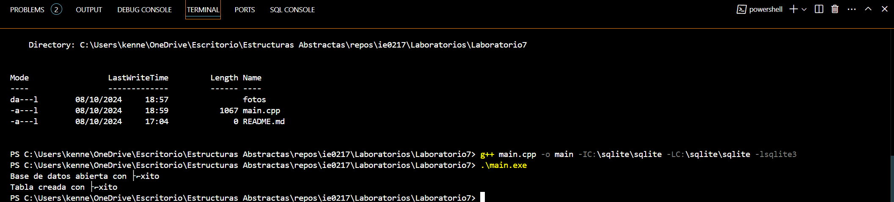


#### Parte 2: Inserción de productos 
##### Se usa la porción de código al insertar la tabla para poder ingresar los valores  e indicar si se ingresaron con éxito(se utiliza para mostrar datos) y cambiando algunas  cosas  nombre de la funcion sql y como no es un mensaje lo que se mostrara , esto anterior se elimina(se utiliza para modificar la tabla)

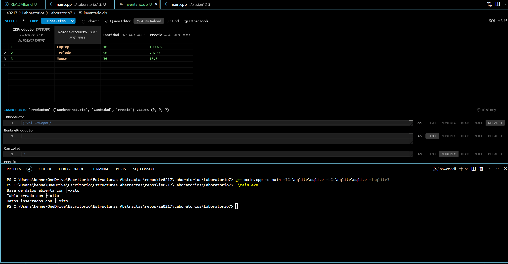


#### Parte 3: Consultas SQL
#### Casi igual a incertar nueva tabla se utiliza para poder mostrar los valores en la consola.

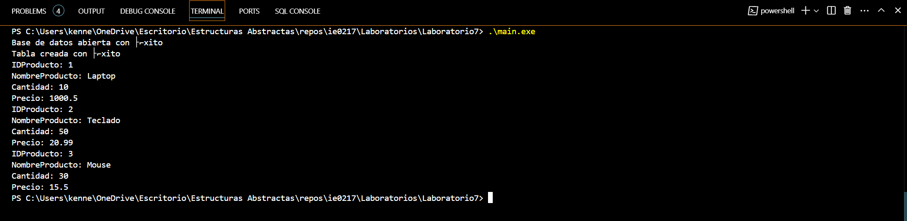

#### Actualizar la cantidad de Mouse a 25 se actualiza siguiendo lo anterior

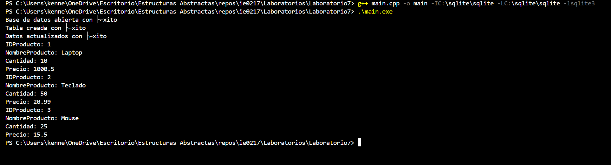

#### Eliminar el producto Teclado
##### Se elimina el producto teclado

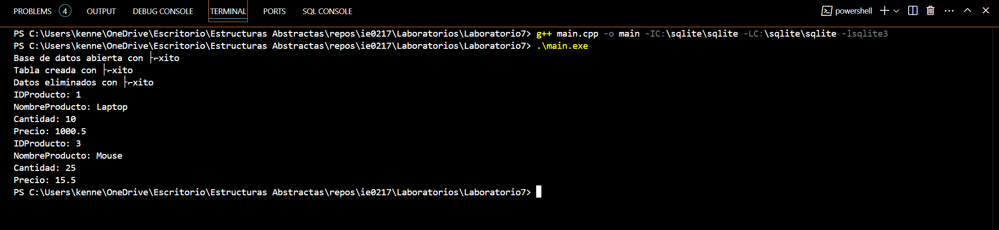
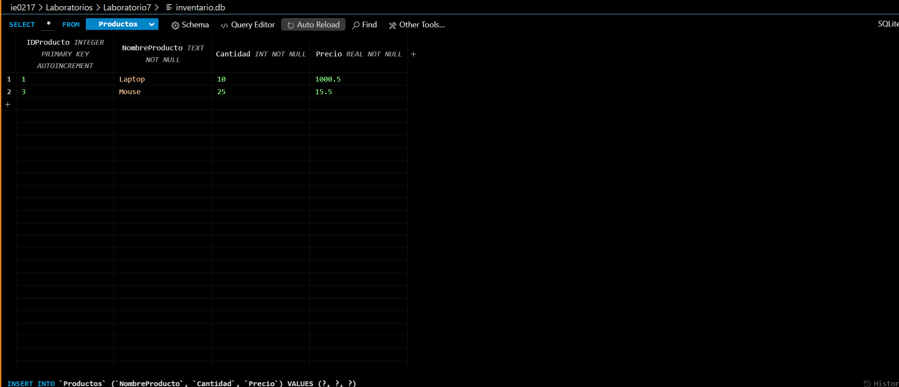

#### Parte 5: Ejecución de las consultas
##### Se utiliza estos códigos como se mencionaba anteriormente para modificar y otro para mostrar datos según la acción que se requiera ejecutar 

```cpp
rc = sqlite3_exec(db, sqlInsert, callback, 0, &errMsg);
if (rc != SQLITE_OK) {
std::cerr << "Error al insertar datos: " << errMsg << std::endl;
sqlite3_free(errMsg);
}

rc = sqlite3_exec(db, sqlSelect, callback, 0, &errMsg);
if (rc != SQLITE_OK) {
std::cerr << "Error al consultar datos: " << errMsg << std::endl;
sqlite3_free(errMsg);
}
```

## Se compila y se ejecuta


```bash
 g++ main.cpp -o main -IC:\sqlite\sqlite -LC:\sqlite\sqlite -lsqlite3 
 
 .\main.exe


```
    


