# Sesión #10: C++ Interfaces Gráficas, FLTK, WxWidgets

#### En esta sesión se explicará el uso de interfaces gráficas como es el caso de C++ además de la instalación requerida de sofware para utilizar la herramienta gráfica de Visual Studio y diferencia entre FLTK y WxWidgets 

## Resumen del documento de dicha información

---

Este documento ofrece una introducción a la creación de interfaces gráficas de usuario (GUI) en **C++** utilizando las bibliotecas **WxWidgets** y **FLTK**. Ambas bibliotecas son ampliamente utilizadas para desarrollar aplicaciones de escritorio multiplataforma con interfaces gráficas nativas y eficientes.

## Introducción a las Interfaces Gráficas (GUI)

Las **interfaces gráficas** permiten a los usuarios interactuar con las aplicaciones mediante elementos visuales como ventanas, botones, menús, y formularios, en lugar de hacerlo a través de comandos de texto. Estas interfaces mejoran la **experiencia de usuario (UX)** al hacer las aplicaciones más accesibles e intuitivas.

### Experiencia de Usuario (UX) vs. Interfaz de Usuario (UI)
- **UX** se refiere a la experiencia global del usuario con una aplicación, incluyendo la facilidad de uso y satisfacción.
- **UI** se enfoca en el diseño y la disposición de los elementos gráficos con los que el usuario interactúa.

## WxWidgets

**WxWidgets** es una biblioteca **multiplataforma** que permite desarrollar aplicaciones gráficas con C++ que funcionan en diferentes sistemas operativos como **Windows, macOS y Linux**. Una característica distintiva de WxWidgets es que utiliza los componentes nativos de cada sistema operativo, lo que garantiza que las aplicaciones tengan una apariencia y comportamiento nativos en cada plataforma.

### Ventajas de WxWidgets:
- **Multiplataforma**: Compatible con varios sistemas operativos.
- **Amplia gama de widgets**: Proporciona muchos elementos gráficos como botones, cuadros de texto, menús, etc.
- **Código abierto** y **gratuito**.
- **Soporte para múltiples lenguajes**: Además de C++, puede integrarse con lenguajes como Python, Perl, Ruby, entre otros.
- **Comunidad activa** y **documentación extensa**: Facilita el desarrollo y la resolución de problemas.

## FLTK

**FLTK (Fast Light Toolkit)** es otra biblioteca de interfaces gráficas para C++, enfocada en ser **ligera y rápida**. Aunque no tiene tantas funcionalidades avanzadas como WxWidgets, es ideal para aplicaciones que requieren **eficiencia** y **simples interfaces gráficas**.

### Ventajas de FLTK:
- **Ligera** y **rápida**: Perfecta para aplicaciones que priorizan el rendimiento.
- **Multiplataforma**: Compatible con Windows, macOS y Linux.
- **Soporte integrado para OpenGL**: Ideal para aplicaciones que requieren gráficos en 3D.
- **FLUID**: Herramienta visual para crear interfaces gráficas sin necesidad de codificación directa.
- **Fácil de aprender y usar**: Su simplicidad la hace adecuada para pequeños proyectos o aplicaciones con requerimientos gráficos básicos.

## Comparativa: WxWidgets vs. FLTK

- **WxWidgets**: Es más robusta, ofreciendo una mayor variedad de widgets y capacidades avanzadas. Es ideal para aplicaciones complejas y multiplataforma que necesitan una integración nativa con el sistema operativo.
- **FLTK**: Más ligera y fácil de usar. Es adecuada para proyectos más simples o cuando la eficiencia es una prioridad. Es una excelente opción para aplicaciones que no requieren interfaces gráficas complejas.

## Consideraciones Finales

- **WxWidgets** es una biblioteca recomendada para desarrolladores que necesitan construir aplicaciones gráficas completas, nativas y multiplataforma, con una amplia gama de funcionalidades.
- **FLTK** es preferible para aplicaciones más sencillas que necesitan interfaces gráficas rápidas y ligeras sin sacrificar el rendimiento.

Ambas bibliotecas son opciones sólidas para la creación de **interfaces gráficas en C++**, y la elección entre ellas dependerá del tipo de aplicación que desees desarrollar y de los requerimientos específicos en términos de complejidad y eficiencia.

# Fotos de códigos en funcionamiento
---
###Hello World in wxWidgets
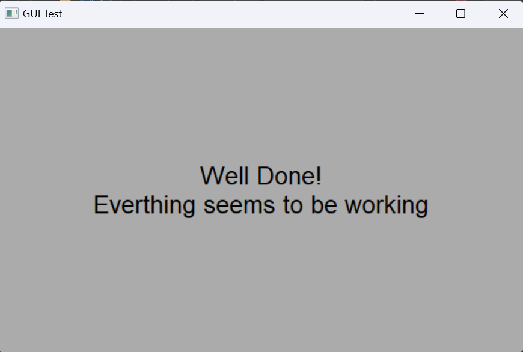

###Creando una ventana básica
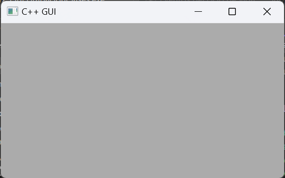

###Controles
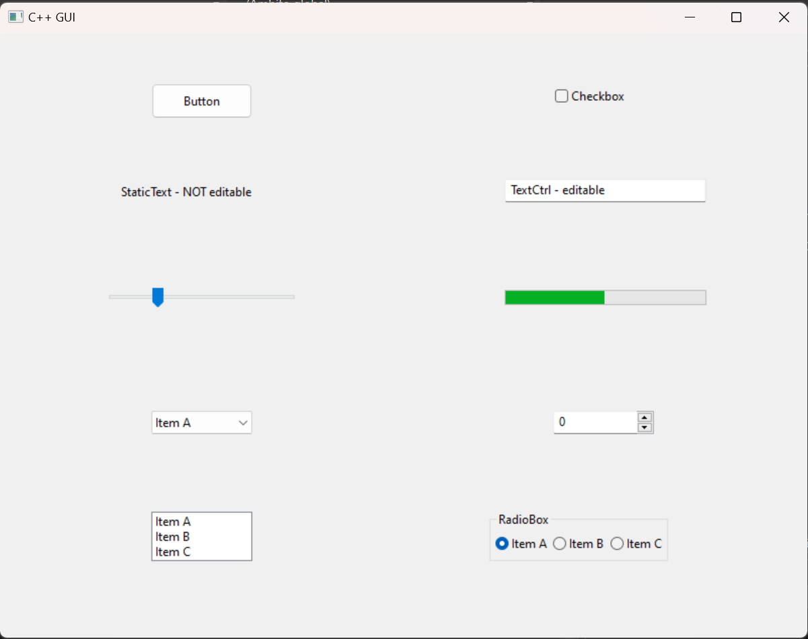

###Estilos
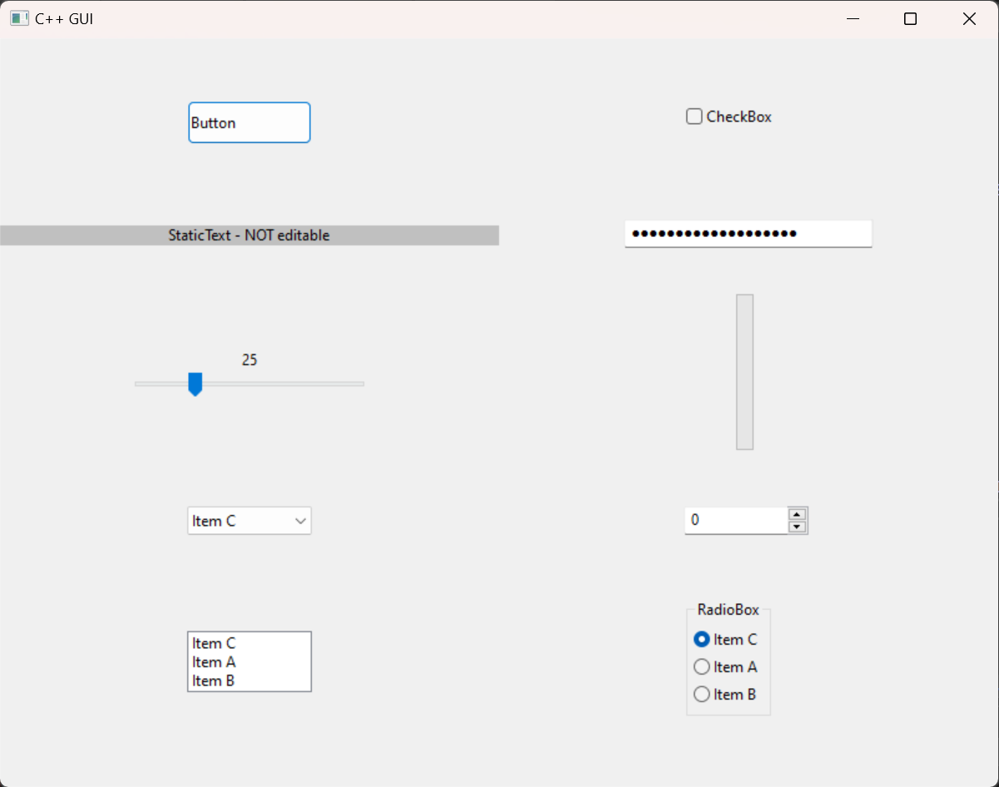

###Eventos Manejo estático
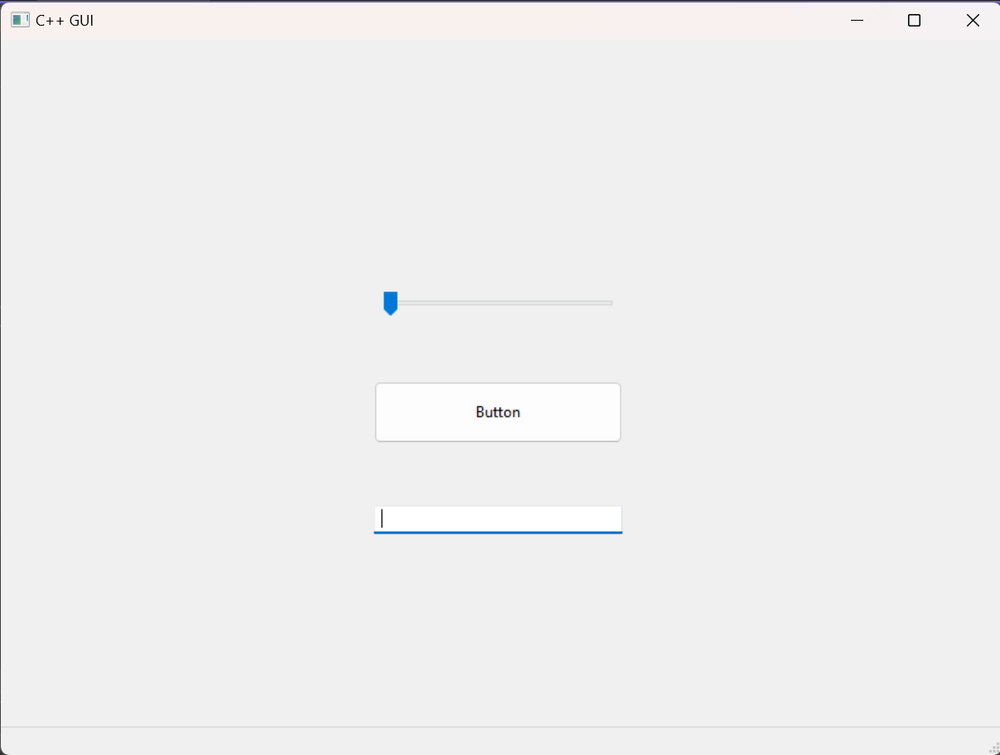

###Eventos Manejo dinámico
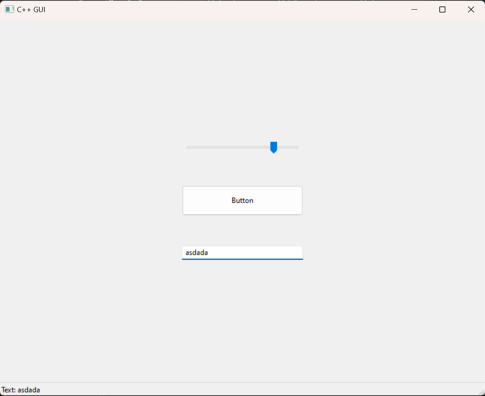

###Propagación de Eventos
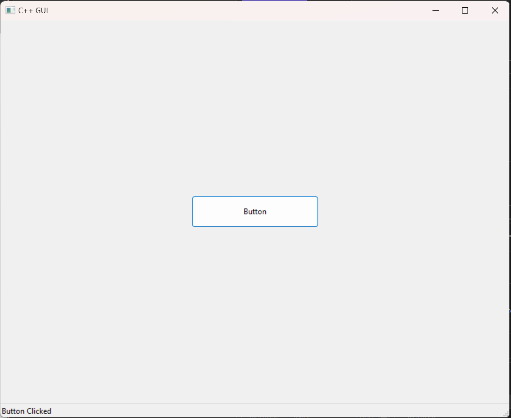

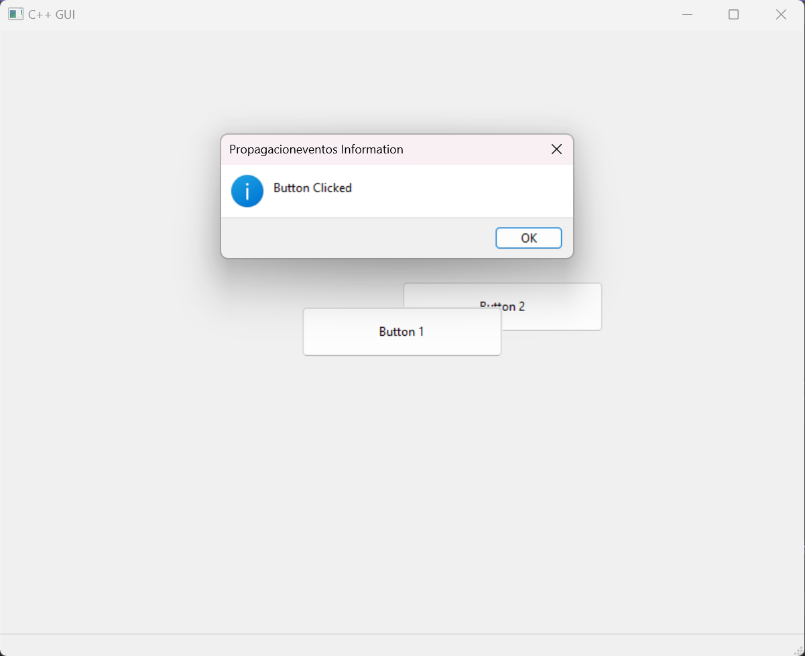

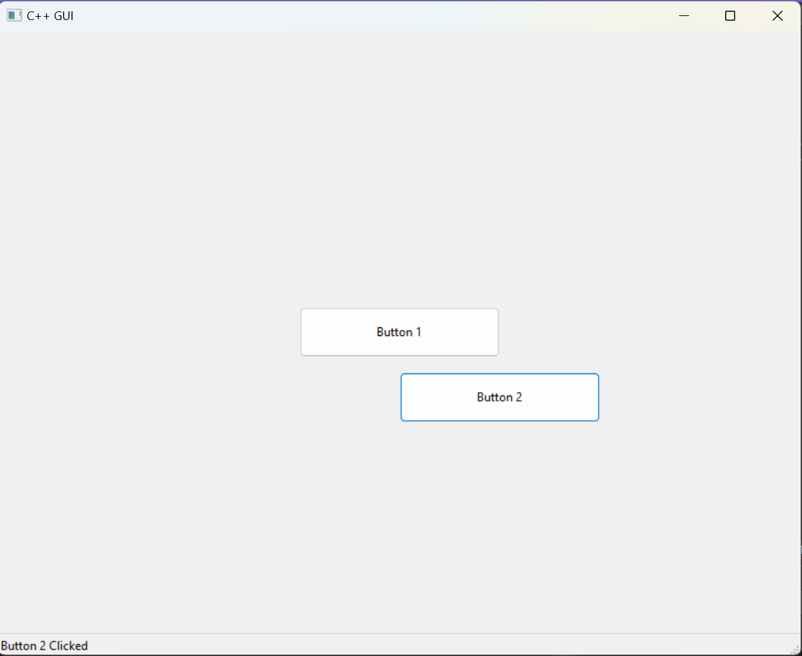

###Eventos Mouse
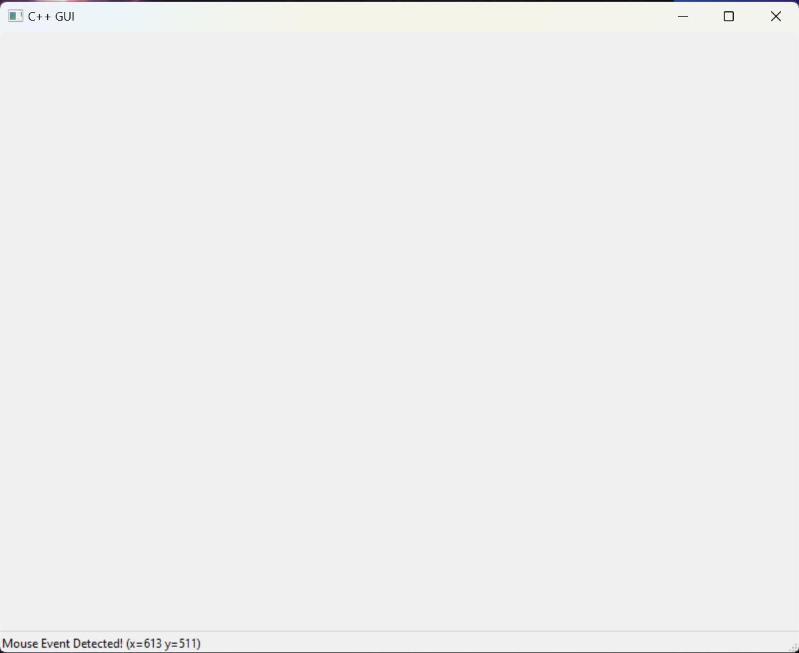

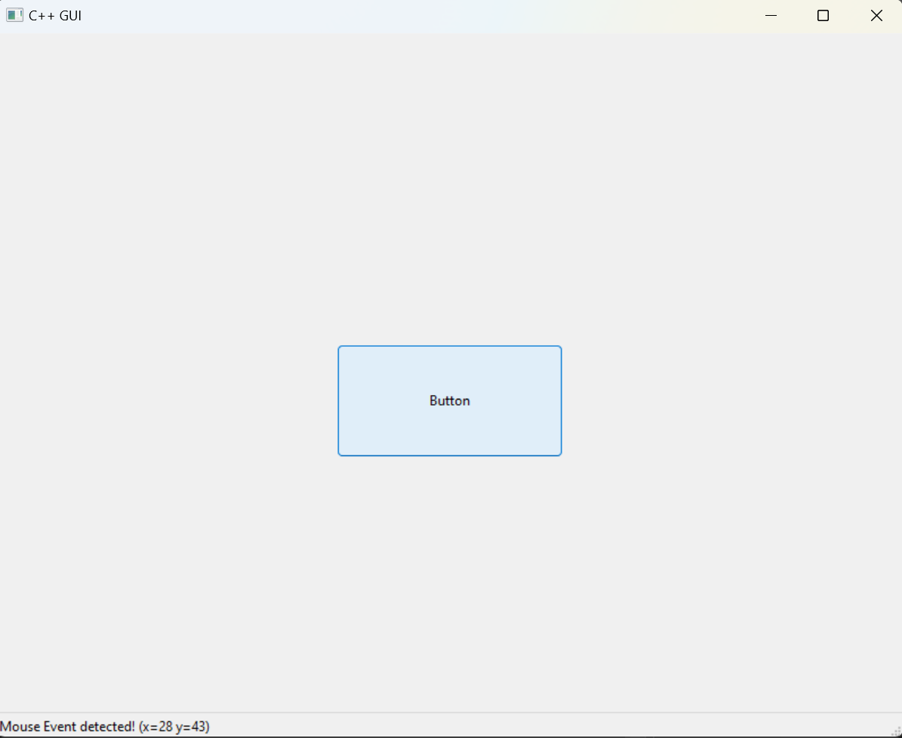

###Eventos Teclado
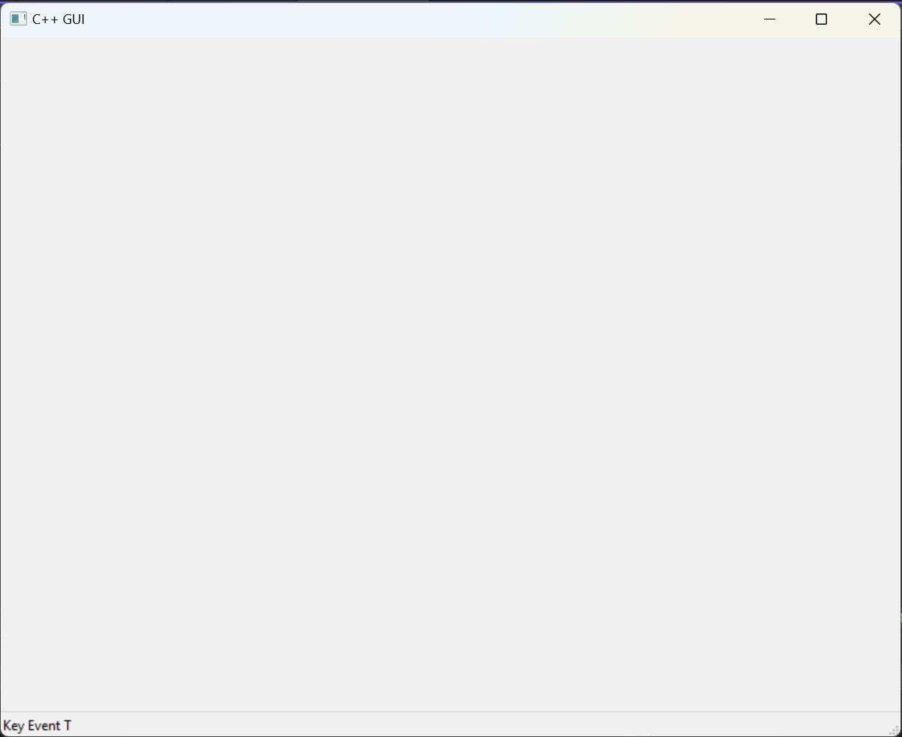

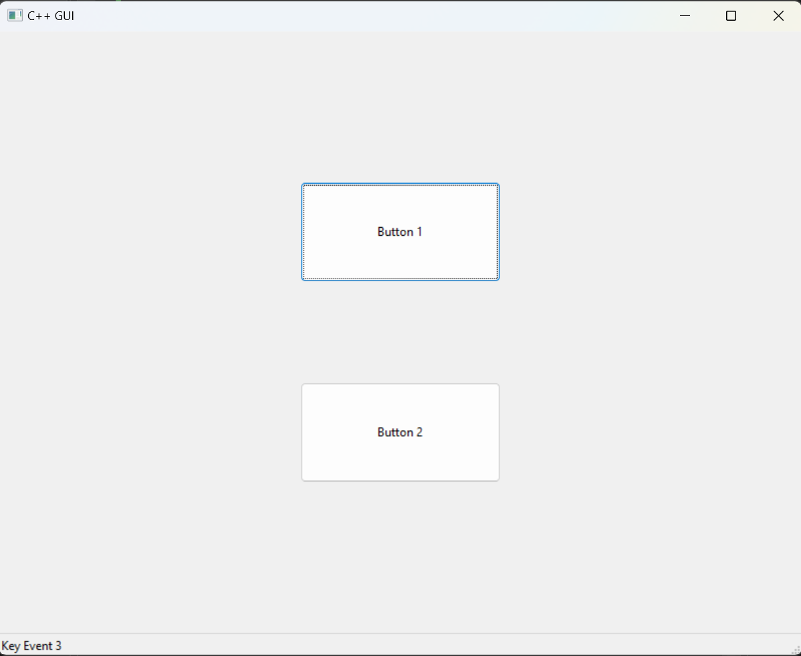

---
