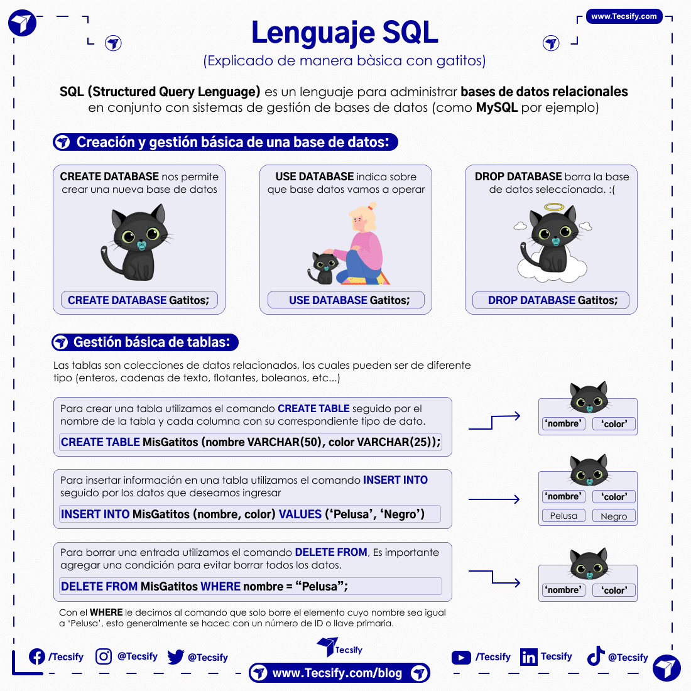
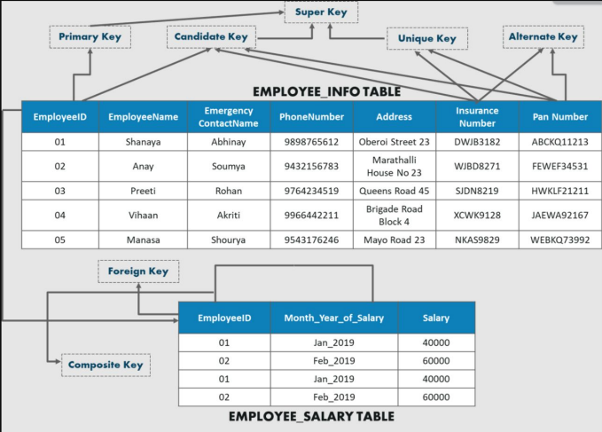
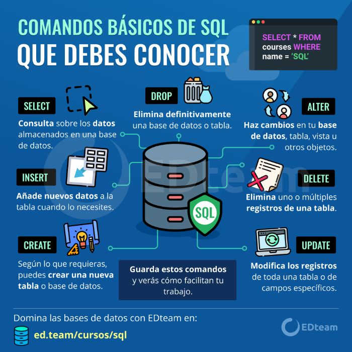
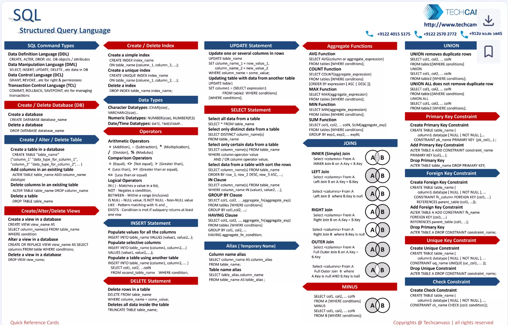

# Sesión #11: Bases de Datos, SQL

#### En esta sesión se explicaran los tipos de bases en específico  SQL y no SQL además de como usar los diferentes comandos para acceder a la información de diferentes tablas de datos y por último crear las tablas de información.

## Resumen del documento de dicha información

---

## Bases de Datos

- **Database**: Un sistema estructurado para almacenar y obtener datos de forma ordenada y rápida.
- **Tipos de bases de datos**:
  - **Relacionales**: Organiza los datos en forma de tablas con filas y columnas. 
  - **No Relacionales**: Más flexibles, como bases de datos de documentos (por ejemplo, JSON), pares clave-valor, etc.
 
## Creacion Bases

### Bases de datos relacionales

- **Table**: Estructura que almacena datos.
- **Row (Registro)**: Es un registro en una tabla.
- **Column (Field)**: Atributo de una entidad.
- **Primary Key**: Campo único para cada registro en una tabla.
- **Foreign Key**: Relaciona datos entre tablas.
- **View**: Tabla virtual creada a partir de una consulta.
- **Index**:Estructura de datos que mejora la velocidad de las operaciones de la base de datos

## Bases de datos no relacionales (NoSQL)
- **Document**: Utilizado en bases de datos orientadas a documentos.
- **Key-Value**: Datos almacenados como una colección de pares clave-valor.
- **Graph**: Datos representados como nodos y aristas en un grafo.
- **Wide Column Store**: Datos almacenados en columnas en lugar de filas.
- **Bucket/Container**: Agrupaciones de datos relacionados en contenedores o buckets.

## Bases de datos - SQL
- **Clave candidata**:Un conjunto de atributos que puede
identificar de manera única una tabla.
- **Súper clave**: Un conjunto de atributos que puede identificar de
manera única una tupla. Incluye claves candidatas, claves
primarias y claves únicas.

- **Clave primaria**:Las claves candidatas que no son seleccionadas
como clave primaria.

- **Clave alterna**: Las claves candidatas que no son seleccionadas
como clave primaria.

- **Clave única**: Similar a la clave primaria, pero puede admitir un
valor NULL en la columna. Puede haber más de una clave
única en una tabla.

- **Clave externa**:Un atributo que solo puede tomar valores
presentes en otra tabla como referencia.

- **Clave compuesta**:Una combinación de dos o más columnas
que identifican de manera única cada tupla en una tabla.

## Representacion de Tablas

### SQL (Structured Query Language):
- **CRUD Operations**: Operaciones básicas realizadas en bases de datos:
  - **Create**: Crear bases de datos o tablas.
  - **Read**: Leer datos de una tabla.
  - **Update**: Modificar registros.
  - **Delete**: Eliminar registros o tablas.
  
## Comandos básicos

### Comandos SQL importantes:

- **CREATE DATABASE**: Crea una base de datos.
- **CREATE TABLE**: Crea una tabla.
- **ALTER TABLE**: Modifica la estructura de una tabla (agregar, renombrar,     eliminar columnas).
- **SELECT**: Consulta para leer datos.
- **INSERT INTO**: Inserta nuevas filas.
- **UPDATE**: Modifica registros existentes.
- **DELETE**: Elimina registros.
- **JOINS**: Combina filas de dos tablas basándose en una columna común.
- **INNER JOIN**: Devuelve filas con valores coincidentes en ambas tablas.
- **LEFT JOIN / RIGHT JOIN**: Devuelve todas las filas de una tabla y las coincidentes de la otra.
- **FULL OUTER JOIN**: Devuelve todas las filas, haya coincidencias o no.
- **CROSS JOIN**: Combina filas de tablas sin una relación específica.
- **CREATE VIEW**:Muestra la tabla de forma virtual.
- **FROM**:Seleciona la tabla a la que se accederá.
- **Where**:Es un filtro de datos que delimita los datos los datos
- **GROUP BY**:Agrega los datos haciendo grupos
- **HAVING**:Filtra los resultados de los datos
- **ORDER BY**: Ordena resultados de una consulta
- **LIKE**:Encuentra patrones en los resultados de datos
- **AND**: Ambos criteros
- **OR**: Uno o otro criterio
- **CASE WHEN**: Similiar al condicional if-else
- **IN**:Verifica un valor específífico en una tabla
- **UNION ALL**:Combina datos de dos o mas consultas sin eliminar las filas duplicadas
- **BETWEEN**:En medio de dos terminos
- **CAST**:Convierte un valor de dato a otro
- **COALESCE**:Devuelve el primer valor no nulo en un lista.
- **AS**: Crea un alias en una columna de forma virtual

## Comandos Generales

### Otras características:
- **Indexes**: Mejoran la velocidad de las consultas.
- **SQL Injection**: Vulnerabilidad que permite la ejecución de comandos SQL no autorizados desde las entradas del usuario.

---
