# Sesión #12: Sistemas de Gestión de Base de Datos (DBMS)Archivo

#### En esta sesión se explicará el uso de herramientas locales y globales para el uso de las bases de datos , en este caso se tomarán como herramientas , MySQL(programa individual) ,MySQL Shell, SQlite(usada en VS code),AWS (nube donde se guardará la información recolectada en MySQL con ayuda de VS code)

## Resumen del documento de dicha información

---

El documento sobre **Sistemas de Gestión de Base de Datos (DBMS)** proporciona una visión general sobre los servidores de bases de datos, los motores de bases de datos y los servicios en la nube relacionados con bases de datos.

**Principales componentes:**
1. **Servidor de bases de datos**: Es un software que almacena, gestiona y recupera datos para otros programas. Proporciona características como almacenamiento centralizado, procesamiento de consultas SQL, gestión de concurrencia y alta disponibilidad. Ejemplos incluyen MySQL, PostgreSQL, Microsoft SQL Server y Oracle Database.

2. **Cliente de bases de datos**: Es una aplicación que interactúa con el servidor para enviar consultas SQL y recibir resultados. Algunos clientes populares son MySQL Workbench, pgAdmin y SQL Server Management Studio.

3. **Motores de bases de datos**: Un motor de base de datos relacional (RDBMS) gestiona datos organizados en tablas relacionadas. MySQL y PostgreSQL son ejemplos notables, con soporte para operaciones complejas y alta conformidad con los estándares SQL.

**Bases de datos en la nube:**
Se menciona servicios gestionados de bases de datos en la nube, como Amazon RDS (AWS), Google Cloud SQL y Azure SQL Database. Estos servicios ofrecen alta disponibilidad, escalabilidad automática y seguridad avanzada.

## Creación y manipulación de base de datos y tablas en MySQL y Shell

### Creando base
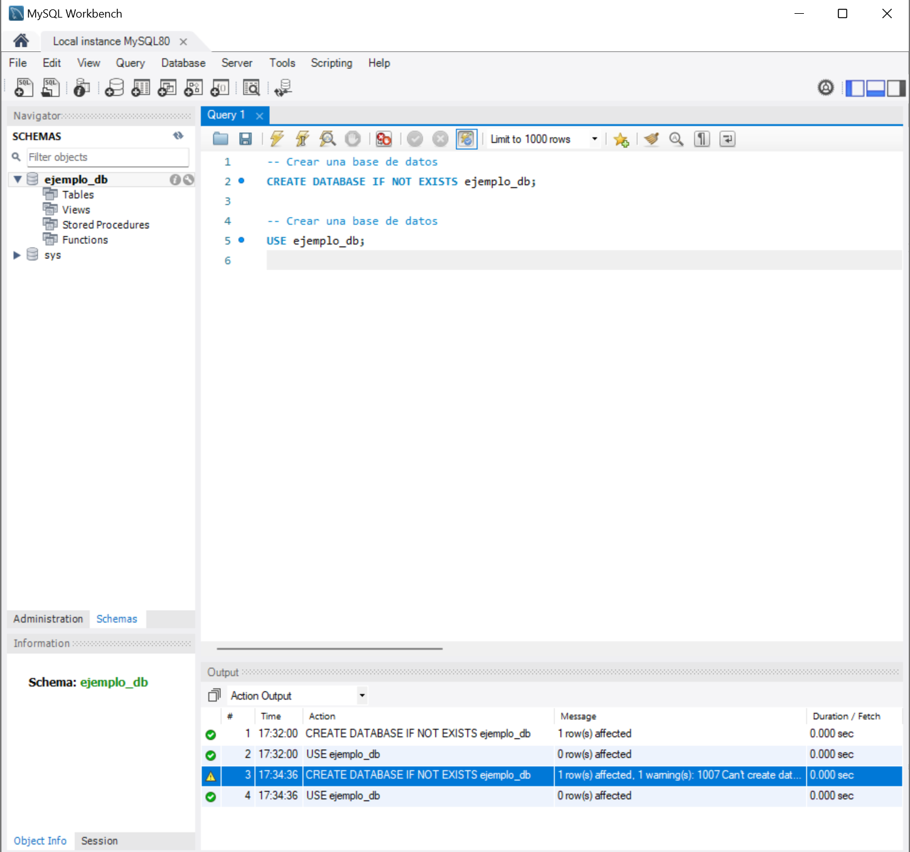
### Creando tabla e insertando datos
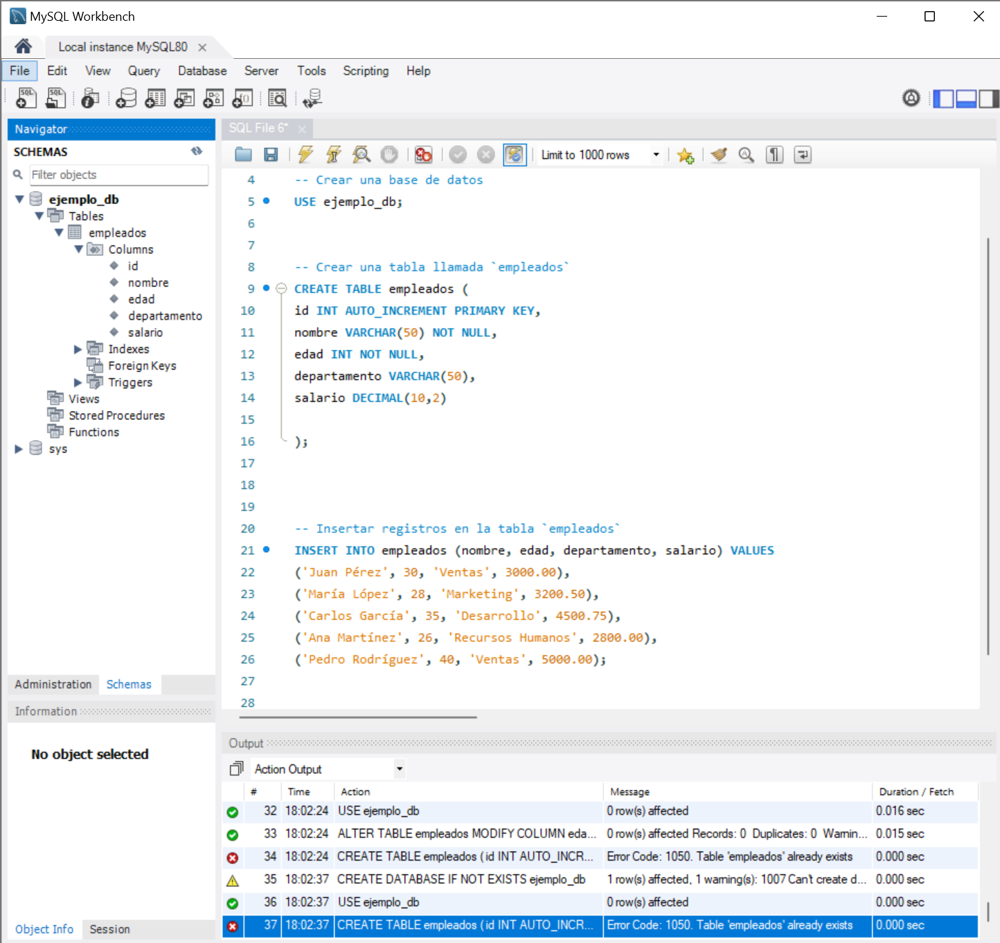
### Mostrando tabla
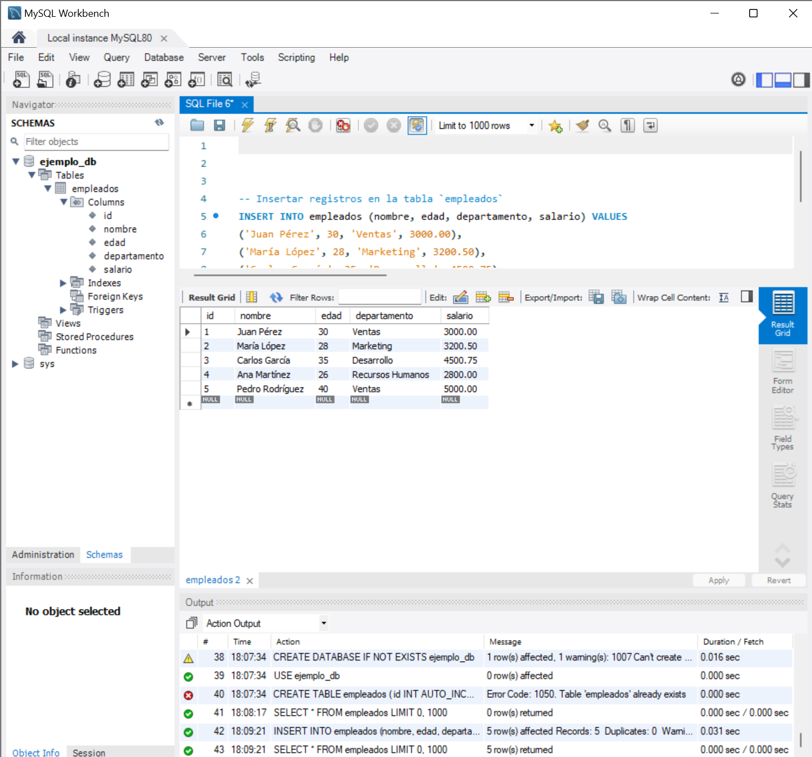
### Mostrando el departamento de ventas
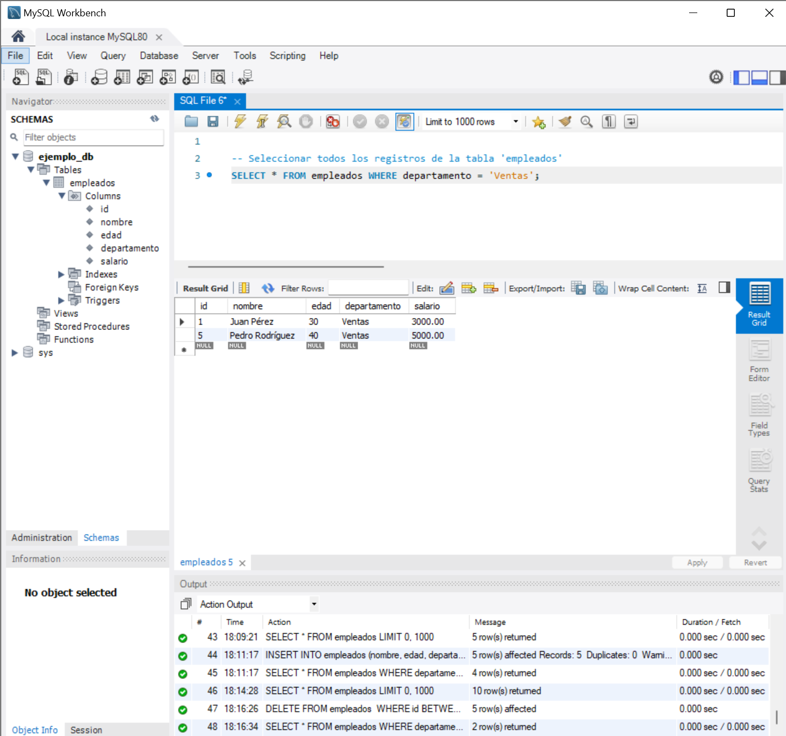
### Mostrando salarios mayores a 3000
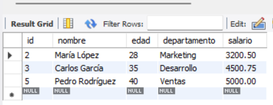
### Mostrando número de empleados en cada departamento
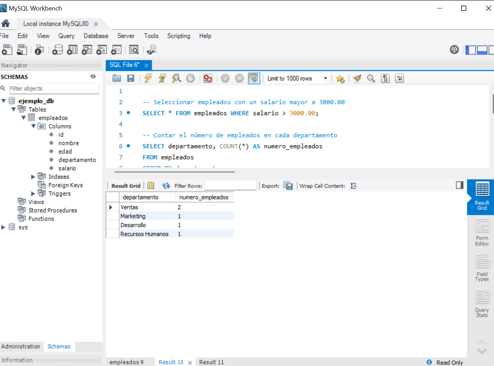
### Mostrando la eliminación de un integrante 
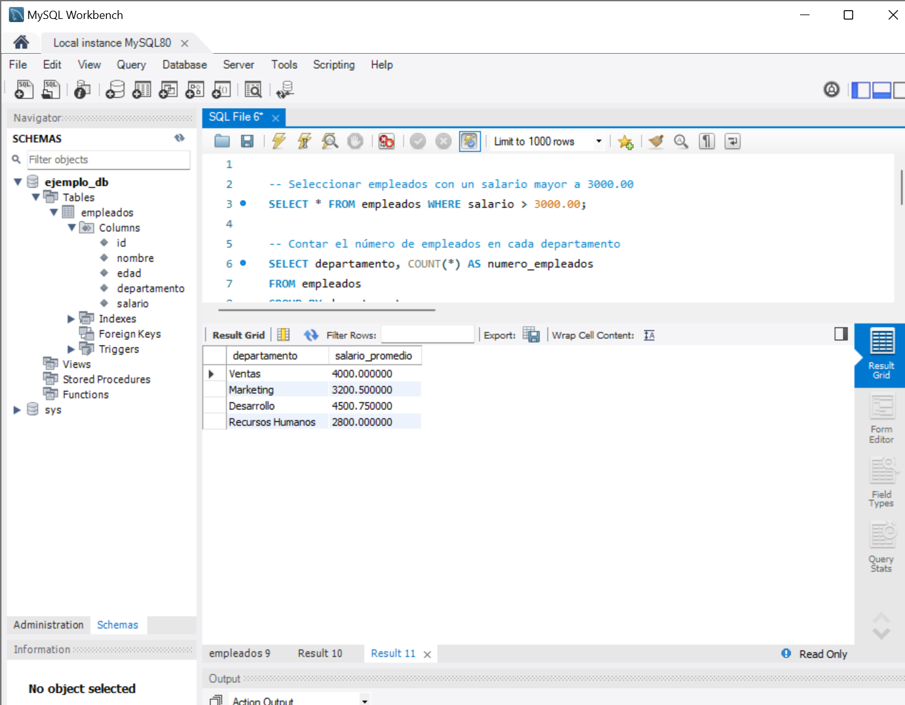
### Cambiando a SQL y haciendo login y mostrando tabla guardada de la base de datos en shell SQL 
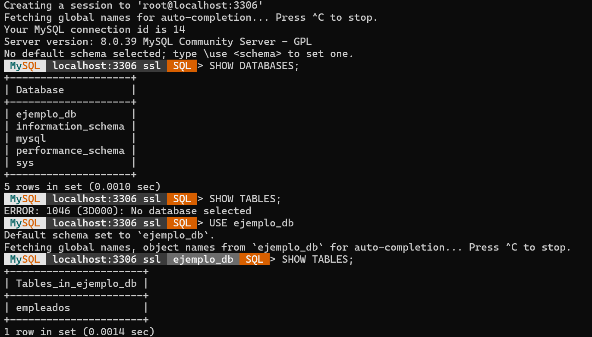
### Ingresando datos en la tabla empledo
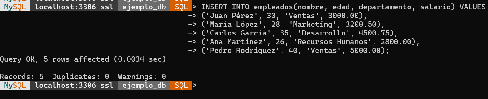

## Uso de SQlite y AWS por medio de Visual Studio

### Creación de tabla e ingreso de datos en SQlite, mostrando los datos
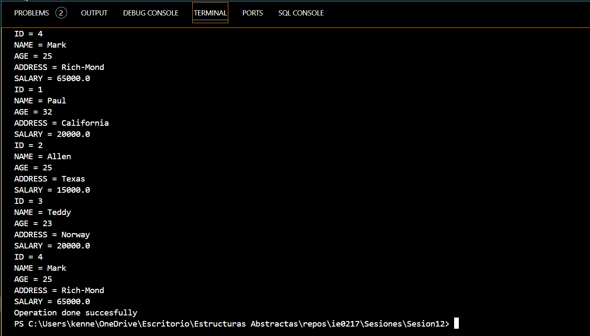

### Mostrando datos de la base de datos creada anteriormente en la nube AWS de base de datos

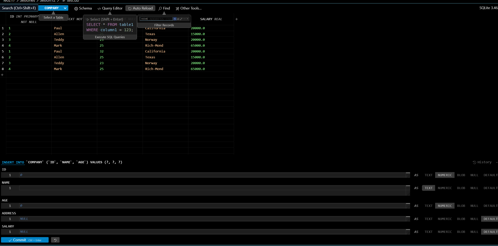

---
