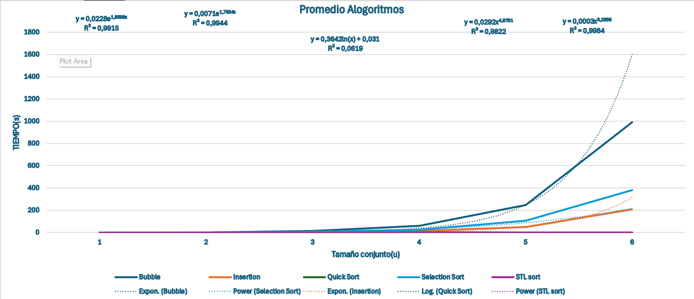
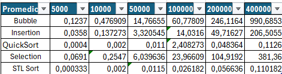
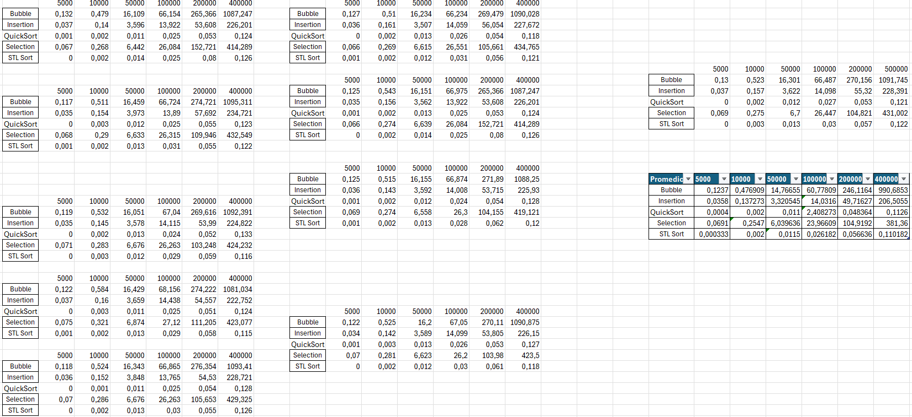

# Tarea #4

_La tarea 4 se basa en responder una serie de preguntas y resolver dos retos de programación en C++ enfocado en bibliotecas STL y algoritmos de ordenamiento_

# Cuestionario sobre Bibliotecas STL y Algoritmos de Ordenamiento🚀 
---

## Algoritmos de Ordenamiento

### 1.¿Qué es un algoritmo de ordenamiento y por qué son importantes en programación?
**Es una técnica utilizada para organizar los elementos de una matriz, lista o arreglo en unorden específico por ejemplo de mayor a menor o al contrario. Son importantes en programación   porque permiten organizar grandes conjuntos de datos de manera eficiente, lo cual es fundamental para muchas aplicaciones y operaciones en informática.**

### 2. Explique el funcionamiento del algoritmo de ordenamiento "Bubble Sort".
**El algoritmo Bubble Sort (ordenamiento de burbuja) funciona tal que :Se recorre el arreglo varias veces comparando elementos adyacentes e intercambia los elementos si están en orden incorrecto.Continúa hasta que no se realicen más intercambios. Su complejidad es O(n^2) en el peor caso, ya que debe comparar cada par de elementos en la lista.**
    
### 3.Explique el funcionamiento del algoritmo de ordenamiento "Selection Sort".
**El algoritmo de ordenamiento "Selection Sort" (Ordenamiento por Selección) funciona de tal forma:Se divide el arreglo en dos partes, una parte ordenada y otra desordenada. La parte ordenada está vacía y la parte desordenada es todo el arreglo.En cada iteración se busca el elemento más pequeño en la parte desordenada luego intercambia este elemento con el primer elemento de la parte desordenada.
Se expande la parte ordenada para incluir este nuevo elemento y repite lo anterior hasta ordenarlo.
Tiene una complejidad de O(n^2) en todos los casos (mejor, promedio y peor).
Esto se debe a que siempre realiza n(n-1)/2 comparaciones,independientemente del orden inicial de los elementos.La ventaja principal de Selection Sort es su simplicidad, pero generalmente es menos eficiente que otros algoritmos como QuickSort o MergeSort para conjuntos de datos grandes.**

### 4.Describa el algoritmo de ordenamiento "QuickSort".¿Cuál es su ventaja principal sobre otros algoritmos de ordenamiento?
**El algoritmo Quick Sort (ordenamiento rápido) funciona funciona:Se utiliza la técnica de "dividir y vencerás".Seleccionando un elemento pivote del arreglo seguidamente particiona el arreglo alrededor del pivote(elementos menores a la izquierda, mayores a la derecha). Luego se repite el proceso recursivamente en los subarreglos resultantes.La complejidad es O(n log n) en el mejor y caso promedio, pero puede degradarse a O(n^2) si se elige un mal pivote.**

### 5. **Explique el concepto de complejidad temporal y cómo se aplica a los algoritmos de ordenamiento.**  
   a. Discuta la complejidad temporal de algoritmos de ordenamiento comunes como **Bubble Sort**, **Insertion Sort**, **QuickSort**, **Selection Sort**, y la función **std::sort** de la STL.

**La complejidad temporal se refiere al tiempo de ejecución de un algoritmo en función del tamaño de la entrada.
Como se puede interpretar los tipos de algoritmos como Bubble Sort,Insertion Sort,Selection Sort tienen todos un tipo de complejidad O(n^2) a algunos dependiendo pueden variar este tipo de complejidad hacia un peor rendimiento, contrario a QuickSort y std::sort que tienen complejidades de tipo O(n log n) en su mayoría obtienen mejor rendimiento.Esto es debido a la forma de procesamiento de donde se encuentra guardada la información ,no es lo mismo recorrer varias veces un arreglo de información completamente o también buscar los espacios vacios en donde se pueda re-ordenar nuestra informacion  a solo recorrerlo una vez ordenando todo por completo.**

### 6. **¿Cuál es la diferencia entre los algoritmos de ordenamiento estables e inestables?**

*a. Proporcione ejemplos de algoritmos de ordenamiento estables e inestables y explique por qué la estabilidad puede ser importante en ciertos escenarios.*

**La diferencia  es que mantienen el orden o no mantienen el orden de los elementos que se repitan , los estables mantienen el orden del primer elemento repetido diferente de los inestables.
Algunos ejemplos de estables: Bubble Sort, Insertion Sort, Merge Sort.**

## QuickSort 

```cpp
// Optimized bubble sort in C++
#include <iostream>
using namespace std;

//Perform bubble sort

void bubbleSort(int array[], int size) {
    //loop to access each array element 
    for(int step=0; step <(size-1); ++step){
    // check if swapping occurs
    int swapped =0;

    //loop to compare two elements
    for (int i=0; i < (size-step-1); ++1){
        //compare two array elements
        //change  > to < to short in descending order
        if (array[i] > array [i+1]){

        //swapping occurs if elements
        //are not in intended order
        int temp = array [i];
        array[i] = array [i+1];
        array[i+1] = temp;

        swapped = 1;

        }
    }

    // no swapping mmeans the array is already sorted
    // so no need of further comparison
    if (swapped == 0)
        break;

    }
}

// print an array 
void printArray(int array[], int size){
    for (int i=0; i <size ; ++i){
        cout << " " << array[i];
    }
    cout << "\n";
}

int main(){
    int data[] = {-2,45,0,11,-9};

    //find the array's length
    int size = sizeof(data) / sizeof(data[0]);

    bubbleSort(data,size);

    cout << "Sorteed Array in ascending Order:\n";
    printArray(data, size);

    return 0;
}
```

**De los inestables tenemos:Selection Sort,Quick Sort**

### Selection Sort

```cpp
//Selection sort in C++

#include <iostream>
using namespace std;

//funtion to swap the position of two elements
void swap(int *a, int *b){
    int temp = *a;
    *a =  *b;
    *b = temp;

}

// function to print an array 
void printArray(int array[], int size) {
    for (int i = 0; i < size; i++){
        cout << array[i] << " ";
    }
    cout << endl;
}

void selectionSort(int array[], int size) {
    for (int step = 0; step < size -1; step++){
        int  min_idx = step;
        for (int i = step + 1; i < size ; i++){
        //To sort in descending order , change > to < int this line.
        //Select the minimun element in each loop.
        if (array[i]< array[min_idx])
            min_idx = i;
        }
        // put min at the correct position
        swap(&array[min_idx], &array[step]);
    }
}

//driver code
int main(){
    int data [] = {20,12,10,15,2};
    int size = sizeof(data) / sizeof(data[0]);
    selectionSort(data,size);
    cout << "Shorted array in Ascending Order:\n";
    printArray(data,size);

    return 0;
}
```


### 7. **¿Cómo funciona la función `std::sort` de la STL y qué algoritmo de ordenamiento utiliza internamente?**  
   a. Discuta la complejidad de `std::sort` y por qué a menudo es más eficiente que los algoritmos de ordenamiento implementados manualmente.
   
**Funciona de tal forma que esta conformado por : 
Iteradores: std::sort toma dos iteradores como parámetros: el iterador de inicio (begin) y el iterador de fin (end). Estos definen el rango de elementos que se van a ordenar.
Es eficiente debido a que está diseñado de forma que se compara manualmente sus implementaciones y su diseño optimizado permite tener una estrategia hibrida**

 

### 8. **Explique la importancia de hacer benchmarks en los algoritmos de ordenamiento.**  
   a. ¿Qué factores se deben considerar al hacer benchmarks de diferentes algoritmos de ordenamiento y cómo se pueden interpretar estos benchmarks?

**La importancia de los Bechmarks es debido a que mide el rendimiento de los programas según su complejidad además de compararlas con otros resultados y llevar al limite las capacidades de los algoritmos además de la optimización de los recursos.**

**Se deben considerar:tamaño de datos,distribución de datos,tipos de datos,recursos del harware,parametros de comparación. Se interpretan dependiendo el tiempo de recorrido del programa, complejidad, uso de memoria.**

### 9. **Compare el uso de memoria de diferentes algoritmos de ordenamiento.**  
   a. Discuta cómo algoritmos como **QuickSort** y **Merge Sort** usan la memoria de manera diferente, incluyendo su complejidad espacial.

### 10. **¿Cómo se elige el algoritmo de ordenamiento más adecuado para un conjunto de datos dado?**  

a. Discuta los factores que influyen en la elección de un algoritmo de ordenamiento, como el tamaño del conjunto de datos, su orden inicial y la necesidad de estabilidad.

**Para seleccionar el tipo de algoritmo de ordenamiento que mas convenga dependerá de factores como: Tamaño del conjunto de datos: Cuando los elementos son pocos se puede optar por Insertion Sort o Bubble Sort contrario a este caso se puede usar QuickSort , MergeSort  que manejan gran cantidad de elementos de forma mas eficiente.
Orden inicial: Si los datos están ordenados de forma aleatorios se usa QuicSort  o si estan parcialmente ordenados se puede usar Insertion Sort y por último si están invertidos se puede usar QuickSort o Merge Sort para mas efectividad.
Estabilidad:Como anteriormente se mencionaba debido a los tipos de datos se va a requerir tipos de ordenamientos estables o inestables segun el orden de los datos .
Consumo de memoria:Si se requiere usar memoria de modo que sea lo mas eficiente se debe optar por QuickSort o Heap Sort. Si se sabe que se utilizará memoria adecional se podría utilizar Merge Sort.
Tipo de datos:Aveces algunos datos están mas optimizados que otros. 
Requerimientos de rendimiento:Se debe tomar en cuenta usar los tipos de ordenamiento mas eficientes si se requiere un tipo de respuesta lo mas rápido posible.**

    

## STL, Iteradores y Algoritmos

### 11. **Nombre cinco contenedores diferentes de la STL y explique brevemente en qué situaciones sería apropiado usar cada uno.**

#### std::vector: Contenedor dinámico que almacena datos de forma contigua.Es usado para acceder por medio de un índice o para  eliminar o añadir datos. 

#### std::list: Implementa una lista doble enlazada. Cada elemento tiene punteros al elemento anterior y siguiente. Cuando se requiere incertar o eliminar muchos elementos y se desea una estabilidad en las posiciones de los elementos.

#### std::deque:Permite el acceso de elementos para ambos accesos de principio o final . Ideal para colas y pilas o cuando se necesita un acceso rápido en los extremos .

#### std::set:Almacena datos unicos y no duplicados ordenados de forma automatica.Ideal cuando se requiere  almacenar datos no duplicados y rapida busqueda incerción o eliminación de elementos.

#### std::map:Almacana pares clave-valor.Se almacenan como arbol binario búsqueda. Ideal cuando se necesita la rapida busqueda incerción o eliminación de elementos.


### 12. **Explique qué son los adaptadores de contenedores y brinde un ejemplo para el cual se podría implementar.**

**Los adaptadores de contenedores son como puentes a los contenedores estándar además permiten usar los elementos en diferentes formas de organización, ejemplo:**

#### std::stack:Da la funcionalidad de una pila (LIFO: Last In, First Out) utilizando un contenedor subyacente. Permite operaciones como ` push, pop, y top`.

#### std::queue: Ofrece la funcionalidad de una cola (FIFO: First In, First Out). Permite operaciones como `push (enqueue) y pop (dequeue)`, así como acceso al frente y al final de la cola.

#### std::priority_queue: Permite almacenar elementos en orden de prioridad. Los elementos más prioritarios son accesibles primero. Actúa como un std::vector.**

### Ejemplo:
```cpp
#include <iostream>
#include <stack>
using namespace std;

int main(){

    //create a stack of ints
    stack<int> numbers;

    //push into stack
    numbers.push(1);
    numbers.push(100);
    numbers.push(10);

    cout << "Numbers are: ";

    //we can access the element by getting the top and popping 
    // until the stack is empty

    while(!numbers.empty()){
        // print top element
        cout << number.top() << " , ";

        //pop top element form stack
        numbers.pop();
    }

    return 0;
}
```
### 13. **Explique el concepto de iteradores en la STL y cómo se utilizan para acceder a elementos en contenedores.**

**Un iterador es un objeto similar a un puntero que representa la posición de un elemento en un contenedor. Se utiliza para iterar sobre
elementos en un contenedor.
Por ejemplo, en un vector llamado nums de tamaño 4.,` begin() y end()` son funciones miembro que devuelven iteradores que apuntan
al principio y al final del vector respectivamente.**


#### - nums.begin() apunta al primer elemento del vector, es decir, el índice 0
#### - nums.begin() + i apunta al elemento en el índice i.
#### - nums.end() apunta a un elemento más allá del elemento final en el vector **

### 14. **Mencione y explique 3 diferentes operaciones soportadas por iteradores en la STL.**  
¿Cuál es la forma de definirlas en el código?


- **Incremento (++): Avanza al siguiente elemento.**
- **Decremento (--): Retrocede al elemento anterior.**
- **Desreferenciación (*): Accede al valor del elemento apuntado.**

### Se definen:

```cpp
Incremento (operator++):

Prefijo: MyIterator& operator++();
Sufijo: MyIterator operator++(int);
Decremento (operator--):

Prefijo: MyIterator& operator--();
Sufijo: MyIterator operator--(int);
Desreferenciación (operator*):

int& operator*();
```
### 15. **¿Qué implementaciones se pueden hacer con iteradores de acceso aleatorio?**  
¿Cuál es la diferencia principal con los iteradores bidireccionales?

**Los iteradores de acceso aleatorio son versátiles y dan una amplia gama de implementaciones por ejemplo: acceso directo a elementos, iteración eficiente, manipulación de subrangos, uso de algoritmos de la STL y  creación de algoritmos personalizados.La principal diferencia es la capacidad de acceso que tiene los iteradores de acceso aleatorio que es bastante comoda diferente de la bidireccional.**

---

### Resumen de Diferencias

| Característica                   | Iteradores de Acceso Aleatorio | Iteradores Bidireccionales |
|----------------------------------|--------------------------------|-----------------------------|
| **Acceso a Elementos**           | Acceso directo a cualquier elemento en \(O(1)\) | Solo acceso secuencial      |
| **Operaciones Soportadas**       | Incremento, decremento, y aritmética | Solo incremento y decremento |
| **Contenedores Asociados**       | `std::vector`, `std::deque`, `std::array` | `std::list`, `std::set`     |
| **Complejidad de Acceso**        | Rápido y eficiente              | Secuencial                  |

### 16. **Proporcione ejemplos de al menos tres algoritmos de la STL y describa sus funciones básicas.**


- ### std::sort : 
**Permite ordenar un contenedor, como un std::vector o un std::array, en orden ascendente.** 
```cpp
//sort algorithm example

#include <iostream> //std::cout
#include <algorithm> //std::sort
#include <vector> //std::vector

bool myfunction(int i,int j) {return (i<j);}

struct myclass{
    bool operator() (int i , int j) {return (i<j);}
}myobject;

int main(){
int myinst[] = {32,71,12,45,26,80,53,33};
std::vector<int> myvector (myints, myints+8);           //43 71 45 26 80 53 33

//using default comparison (operator <):
std::sort (myvector.begin(), myvector.begin()+4);      //(12 32  45 71)26 80 53 33     

//using function  as comp
std::sort (myvector.begin()+4, myvector.end(), myfunction);  //12 32 45 71(26 33 53 80)

//using object as comp
std::sort (myvector.begin(), myvector.end(), myobject);     //(12 26 32 33 45 53 71 80)

//print out content:
std::cout << "myvector contains: ";
for (std::vector<int>::iterator it=myvector.begin(); it!=myvector.end(); ++i)
    std::cout << '' << *it;
std::cout  << '\n';


return 0;
}


```


- ### std::find : 
**Permite buscar el elemento igual al valor == y devolver al primer elemento encontrado.** 
```cpp
#include <algorithm>
#include <array>
#include <cassert>
#include <complex>
#include <iostream>
#include <vector>
 
int main()
{
    const auto v = {1, 2, 3, 4};
 
    for (const int n : {3, 5})
        (std::find(v.begin(), v.end(), n) == std::end(v))
            ? std::cout << "v does not contain " << n << '\n'
            : std::cout << "v contains " << n << '\n';
 
    auto is_even = [](int i) { return i % 2 == 0; };
 
    for (const auto& w : {std::array{3, 1, 4}, {1, 3, 5}})
        if (auto it = std::find_if(begin(w), end(w), is_even); it != std::end(w))
            std::cout << "w contains an even number " << *it << '\n';
        else
            std::cout << "w does not contain even numbers\n";
 
    std::vector<std::complex<double>> nums{{4, 2}};
    #ifdef __cpp_lib_algorithm_default_value_type
        // T gets deduced making list-initialization possible
        const auto it = std::find(nums.begin(), nums.end(), {4, 2});
    #else
        const auto it = std::find(nums.begin(), nums.end(), std::complex<double>{4, 2});
    #endif
    assert(it == nums.begin());   
}
```
- ### std::binary_search :  
**Busca un valor específico en un rango de elementos. Si el valor se encuentra, devuelve true; de lo contrario, devuelve false.**
```cpp
#include <algorithm>
#include <cassert>
#include <complex>
#include <iostream>
#include <vector>
 
int main()
{
    const auto haystack = {1, 3, 4, 5, 9};
 
    for (const auto needle : {1, 2, 3})
    {
        std::cout << "Searching for " << needle << '\n';
        if (std::binary_search(haystack.begin(), haystack.end(), needle))
            std::cout << "Found " << needle << '\n';
        else
            std::cout << "No dice!\n";
    }
 
    using CD = std::complex<double>;
    std::vector<CD> nums{{1, 1}, {2, 3}, {4, 2}, {4, 3}};
    auto cmpz = [](CD x, CD y){ return abs(x) < abs(y); };
    #ifdef __cpp_lib_algorithm_default_value_type
        assert(std::binary_search(nums.cbegin(), nums.cend(), {4, 2}, cmpz));
    #else
        assert(std::binary_search(nums.cbegin(), nums.cend(), CD{4, 2}, cmpz));
    #endif
}
```


### 17. **¿Cómo podría utilizar un algoritmo personalizado con la STL?**


**Se puede hacer uso de algoritmo de personalizado con la STL ya que se facilita por medio de funciones lambda, funciones personalizadas y de comparación  por ejemplo, los algoritmos std:: sort,for?each y transform aceptan parametros funciones para personalizar  su comportamiento**

## Templates y Ordenamiento

### 18. **¿Cuál es el papel de los templates en la implementación de funciones de ordenamiento?**  
a. Explique cómo los templates se pueden utilizar para crear funciones de ordenamiento genéricas que funcionen con diferentes tipos de datos.
    
**Son una característica del lenguaje que permiten crear código genérico que puede trabajar con diferentes tipos de datos y estructuras
de datos. En otras palabras, utilizar templates permite escribir funciones y clases que pueden ser usadas con distintos tipos de datos
sin necesidad de escribir código específico para cada tipo.
Los templates se definen mediante la palabra clave template seguida de una lista de parámetros de tipo, que pueden ser nombres de
tipos o valores constantes. Estos parámetros se utilizan para definir los tipos de los argumentos y variables dentro de la función o clase
template.**

### 19. **Explique de qué forma se implementan templates con múltiples parámetros en C++.**

**
Los templates de múltiples parámetros son útiles para hacer el código más flexible y reutilizable, permitiendo trabajar con tipos diferentes sin tener que sobrecargar las funciones o clases manualmente.
Se puede implementar templates con múltiples parámetros usando la palabra clave `template`, y estos parámetros pueden ser tanto tipos de datos (typename o class) como valores constantes. Esta capacidad permite una gran flexibilidad en C++ para escribir código genérico y eficiente.**

## Excepciones en C++

### 20. **¿Qué son las excepciones en C++ y cómo se pueden usar para manejar errores durante las operaciones de ordenamiento?**  
    a. Proporcione un ejemplo de cómo usar excepciones para manejar un posible error en un algoritmo de ordenamiento.

**Es un evento inesperado que ocurre durante la ejecución de un programa, por ejemplo dividir entre cero. El proceso de manejo de estetipo de errores en C++ se conoce como manejo de excepciones.**

### Ejemplo
```cpp
#include <iostream>
#include <stdexcept>

using namespace std;

//Se da un ejemplo de lo útil que son las excepciones para que nuestro
//código sea mas robusto

int main() {
    int numerador, denominador, resultado ;

    cout << "Ingrese el numerador";
    cin >> numerador;


    cout << "Ingrese el numerador";
    cin >> denominador;

    try{
        if (denominador == 0) {
            throw runtime_error("Error: el denominador no puede ser cero");
        }
        resultado = numerador / denominador;
        cout << "El resultado es : " << resultado << endl;
    } catch (const exception& e){
        cerr << e.what() << endl;
    }
    return 0;
}
```

### 21. **Describa los bloques `try`, `catch` y `throw` y cómo se utilizan para el manejo de excepciones en C++.**

**El manejo de excepciones se realiza mediante los bloques try , catch , y throw .**

**try: En este bloque se coloca el código que puede generar una excepción.**

**throw: Se usa para lanzar una excepción cuando ocurre un error.**

**catch: Se encarga de capturar y manejar las excepciones lanzadas.Se menciona también el uso de `...` en un catch cuando no se conoce el tipo de excepción que puede ocurrir.**

### 22. **Nombre al menos tres excepciones estándar proporcionadas por C++ y proporcione ejemplos de situaciones en las que podrían ser útiles.**

- #### std::bad_typeid : Cuando se ingresa a la consola un texto que no es permitido.
- #### std::runtime_error: Esta excepción se utiliza para representar errores generales que ocurren en tiempo de ejecución. Es una excepción base que puede ser utilizada para situaciones no específicas. Por ejemplo al dividir por cero se puede llamar a esta excepción.
- #### std::invalid_argument: Caundo se recibe un argumento inválido,esto ocurre talvez al querer convertir una cadena de texto a entero y halla numeros y letras mezclados

### 23. **¿Cuál es la forma de manejar errores inesperados o no considerados durante la elaboración del código?**

**Como anteriormente se mencionaba la haciendo uso de la captura genérica de excepciones: Se puede utilizar `catch(...)` para capturar cualquier tipo de excepción, incluso si no fue específicamente considerada.**

## Expresiones Regulares

### 24. **Describa cómo las expresiones regulares se pueden usar para validar o filtrar datos antes del ordenamiento.**  
    a. Proporcione un ejemplo de un escenario en el que la validación de datos mediante expresiones regulares sea necesaria antes de realizar el ordenamiento.
**Las expresiones regulares permiten validar y filtrar datos antes del ordenamiento, asegurando que solo los datos que cumplen con un formato específico sean procesados. Esto es útil en muchos escenarios donde el formato de los datos es crucial, como números telefónicos, correos electrónicos o fechas.**

### Ejemplo
```cpp
#include <iostream>
#include <regex>

using namespace std;

int main() {
    auto const regex = regex("(my|your) regex");

    auto const myText = string("A piece of text that contains my regex.");
    bool const myTextContainsRegex = regex_search(myText , regex);

    auto const yourText = string("A piece of text that contains my regex.");
    bool const yourTextContainsRegex = regex_search(yourText , regex);

     auto const theirText = string("A piece of text that contains my regex.");
    bool const theirTextContainsRegex = regex_search(theirText , regex);

    cout << boolalpha 
         << myTextContainsRegex << '\n'
         << yourTextContainsRegex << '\n'
         << theirTextContainsRegex << '\n';
}
```
### 25. **Enumere al menos tres caracteres especiales comúnmente utilizados en expresiones regulares y describa sus funciones.**

- #### Punto (.): Coincide con cualquier carácter excepto un salto de línea.
- #### Asterisco (*): Representa cero o más repeticiones del carácter anterior.
- #### Más (+): Representa una o más repeticiones del carácter anterior.

### 26. **¿Cuál es la diferencia entre `std::regex_match` y `std::regex_search` en C++?**
**La  diferencia entre `std::regex_match` y  `std::regex_search` es que la primera busca que toda la cadena de texto coincida , mientras que regex_search solo requerirá que un pedazo de la cadena de texto coincida**.

### 27. **¿Cómo se puede utilizar `std::regex_replace` en C++ para modificar cadenas de texto?**

**Por ejemplo si se quiere remplazar los espacios de un texto por `(_)` se recurre a `std::regex_replace` asignando `string texto("asd asd")`, `regex espacio(" ")`, `string reemplazo(_)`, de tal forma que `std::regex_replace(texto,espacio,reemplazo)` entonces toma el texto , nota los espacios y los remplaza por lo que se le asignó.**
## Makefile

### 28. **¿Qué es un Makefile y cómo se puede usar para automatizar la compilación de un programa en C++ con múltiples algoritmos de ordenamiento?** 
a. Describa cómo escribiría un Makefile que compile diferentes algoritmos de ordenamiento en ejecutables separados.

**Un Makefile automatiza la compilación de programas y define qué partes deben recompilarse.**

**Esta constituido por algunos factores para que funcione.**

#### Reglas:
**Constan de un target, dependencias y comandos**
#### Dependencias:
**Archivos necesarios para crear el target.**
#### Comandos:
**Instrucciones que se ejecutan para construir el target. Deben estar precedidos por una tabulación.**
#### Variables: 
**Facilitan la reutilización de valores en todo el archivo.**
#### Phony targets: 
**Son targets que no representan archivos físicos, como clean.**
#### Reglas de patrón:
**Permiten construir varios archivos con el mismo patrón o extensión.**

**Para poder automatizar el makefile se deben separar los archivos cabecera(.hpp)) con los archivos principales(.cpp) luego de que se compile usando `mingw32-make make` se hace automaticamente segun le hayamos específicado que nos genere el ejecutable.**

---

## Código 1:Benchmarks en algoritmos de ordenamiento 

#### Nuestro código se trata de desarrollar un benchmarking del rendimiento de variosalgoritmos de ordenamiento en conjuntos de datos generados aleatoriamente.Se usan algoritmos como: Bubble Sort, Insertion Sort, Quick Sort,Selection Sort y la función std::sort de la STL_

**Se debe mencionar que se cambió el conjunto de datos de 500000 a 400000 ya que duraba demasiado mas una hora veinte minutos por turno**

## Gráfica del promedio de datos de los diferentes algoritmos






### *Como corresponde al ordenamiento de algorimos se nota la eficiencia en los algoritmos QuickSort y STL sort de tipo logaritmico y para las demás de tipo potencial*

### Algunos errores Código #1:
- Al implementar el algoritmo de Quick Sort se debe realizar  primero la función que nos va a dividir nuestro arreglo y después la implementación del Quick Sort ya que daba errores de que no existía ningún arreglo para tomar como pivote.
- Se implementa la funcion de la STL `std::fixed` para lograr que nuestro contador reflejado logre mostrar la precisión de nuestros segundos o milisegundos , esto no se mostraba al correrlo y se da solución solo ingresandolo una vez en nuestro main para todos los demás casos de algoritmos.

###  Para ejecutar:
```cpp**
   mingw32-make make
   
   Linux: make
 ```
### Link Doxyfile:

startling-fox-3dd6e7.netlify.app

## Código 2 :Simulador de Gestión de Proyectos de Construcción

_Es un simulador donde se debe desarrollar un programa que los templates y el uso de librerias STL , de modo que se crean proyectos y sus respectivas tareas. El programa tiene como sentido que los usuarios puedan agregar, eliminar y gestionar tareas dentro de proyectos, además de  ordenar tareas y mostrar resúmenes de proyectos.
 ._

### Algunos errores Código #2:
- Algunos errores pequeños como olvidar el #endif y cuestiones como invocar funciones con el nombre diferente al que se habia declarado además de errores con el contructor `error: only constructors take member initializers`
- Un error con definir la clase proyecto, se define como default para solucionar el error.Error mostrado `undefined reference to 'Proyecto<int>::Proyecto(std::__cxx11::basic_string<char, std::char_traits<char>, std::allocator<char> > const&)'`.
- Se muestra un error latente sobre el contructor no encuentra  los parametros para crearse`no matching function for call to 'Proyecto<int>::Proyecto()'` por lo que se decide solo dejar un tarea.hpp y un proyecto.hpp para evitar errores con el template y constructor.


###  Para ejecutar:
```cpp**
   Windows: mingw32-make make2
   Linux: make make2
 ```
### Link Doxyfile:

monumental-genie-0fc8af.netlify.app

## Autor ✒️


* **Kenneth Daniel Vizcaíno Jiménez** - *TAREA 4* - [VIXCA22](https://github.com/VIXCA22)


---